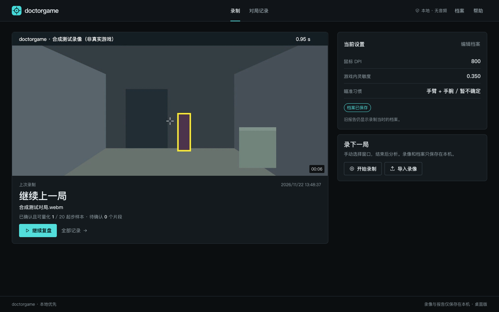
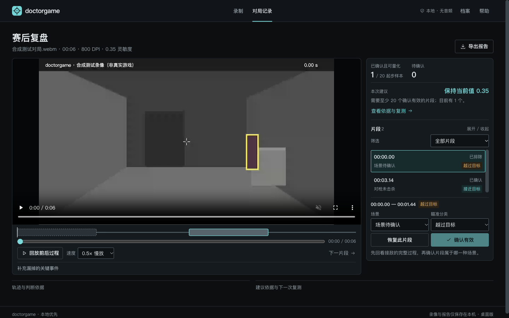

# doctorgame · 灵敏度实验室

项目名称：`doctorgame` · GitHub 仓库：[zhoujoe194-maker/doctor-game](https://github.com/zhoujoe194-maker/doctor-game)。

面向无畏契约的本地桌面原型：后台记录游戏画面，赛后回放瞄准片段，结合玩家习惯提出可复测的灵敏度实验。

doctorgame 希望把「灵敏度不顺手」拆成可回看的具体问题：击杀前是否甩过头、被击杀前是否来得及对准、无击杀对枪中是否反复补拉，以及预瞄时的方向变化与减速过程。玩家的瞄准方式、握姿和可移动空间会帮助解释这些线索，并确定下一次应该复测什么。

**当前交付是可运行原型，不是已经验证有效的灵敏度优化产品。** 尚无真实对局训练数据或准确率评估。击杀/死亡目前是本地 HUD 文本的自动候选，仍需用户回放确认；这不是经过真实对局评估的识别模型。

## 新窗口与协作入口

统一协作基线是 **`origin/main`**。新窗口先 fetch，再读
[新窗口入口](docs/start-here.md)、[项目当前状态](docs/project-status.md) 和
[协作约定](docs/collaboration.md)，并在任务 Issue 认领 owner/文件范围。
不要在共享 dirty 目录同时写；一个窗口一个独立 worktree 和
`codex/<issue>-<scope>` 分支。Issue 是协调入口，不是原子锁。

## 界面预览





当前源码状态与最新验收索引见 [项目当前状态](docs/project-status.md)。
[自动击杀/死亡候选独立验收](docs/event-detection-validation.md) 与
[全界面重设计及六组前后截图](docs/full-ui-validation.md) 记录历史评审证据；
历史 PR 链由 Codex 在统一 main 整合中保留，最终 main SHA、合并状态和任务回执以
GitHub Issue/PR 及负责人确认为准。玩家流程、桌面 beta 等历史记录继续保留。

历史安装包是旧评审产物，**不含最新自动事件识别和当前源码 UI**；用户当前没有要求
重新打包，本轮不更新安装包、Release 或 Steam。

## 核心流程

填写玩家档案 → 填写录像中的玩家名 → 选择游戏窗口并后台记录/导入整段录像 → 赛后提取轨迹与 HUD 候选片段 → 按场景回放确认 → 小幅试用或保持原值 → 在相同条件下复测。

## 历史安装包

此前 Windows x64 beta.1 评审包已保留在历史验证记录中；它是未签名历史产物，
**不代表当前源码，也不含后续自动击杀/死亡识别与新 UI 修正**。用户没有要求本轮
重新打包，因此这里不提供或更新“latest”下载。安装、升级和数据保留说明仍见
[Windows 使用说明](docs/windows.md)；历史安装/升级证据见
[桌面 beta 验收](docs/desktop-beta-validation.md)。源码仓库不存放安装包或玩家录像。

## 开发运行

需要 Node.js 22.12+。支持 npm 或 pnpm。

```sh
npm install
npm run setup:desktop
npm start
```

不安装桌面运行时也可以预览、导入录像或使用浏览器屏幕共享录制：

```sh
npm run dev
```

访问 <http://127.0.0.1:4173>。浏览器录制时必须保持页面打开；桌面版在录制时关闭窗口会隐藏到托盘，可从托盘停止。

多窗口并行测试时每个目录使用独立端口，避免复用别人正在运行的服务：

```sh
# POSIX
DOCTORGAME_UI_PORT=4271 npm run test:ui
```

```powershell
# PowerShell
$env:DOCTORGAME_UI_PORT = "4271"
npm run test:ui
```

默认端口仍为 4173；必须为 1024–65535 的整数，端口被占用会明确失败而不是复用。测试输出、Electron user-data 和依赖也应留在各自目录。

未来用户明确授权更新安装包时，Windows x64 构建命令（安装依赖后）：

```sh
npm run dist:win
```

运行目录位于 `release/0.2.0-beta.1/doctorgame-win32-x64/`；安装器和 SHA-256
位于同版本的 `installer/`。`npm run pack:win` 只生成运行目录。
打包后的整个目录也作为 Steam depot 输入，见 [SteamPipe 准备说明](steam/README.md)。
PR 与默认手动 Windows CI 只运行源码测试和 Electron smoke；只有手动触发并设置 `build_installer=true` 才构建、安装验证并上传 installer artifact，不创建 Release 或执行 Steam 上传。当前用户未授权更新安装包/Release/Steam；历史安装包不代表当前源码。

这个源码仓库不包含生成的运行包、依赖目录或玩家录像。项目介绍中的界面图片来自原型和明确标注的合成示例。

打包脚本仅复制运行所需的界面和桌面代码，避免将开发依赖带入安装目录。如果无法访问 Electron 的默认下载地址，可按 Electron 官方安装文档配置下载镜像后重试。

## 已有功能

- 玩家档案：DPI、基础灵敏度、敌人轮廓颜色、手臂/手腕/混合瞄准、趴握/抓握/指握、实际可移动宽度、控制感。
- 手动选择窗口、开始/结束后台录像；不录音。桌面版按块写盘，浏览器版按块写入 IndexedDB。
- 每次录像保存当时的档案；后来修改档案不会篡改旧报告的分析条件。
- 本地赛后逐帧抽样，查找敌人颜色轮廓和目标相对准星的位移。
- 多个背景区域的位移一致性估计，收集预瞄候选片段；方向反转与低频位移速度仅供观察。
- 回放、确认和修改片段类型；按击杀、被击杀、对枪未击杀、预瞄分类和筛选；排除误检后可以恢复。
- 本地 HUD OCR 根据录像中的玩家名自动给出本人击杀/死亡候选；提供时间、左右参与者、置信度与来源，可跳转慢放确认/纠正/排除。自动候选仍是 observation，不进入量化样本。
- 0.5× / 0.25× 慢放，以及包含前后过程的片段回放；按场景显示不同的观察重点。
- 在当前播放位置补充算法漏掉的关键事件，保留前 3 秒和后 1 秒。手动事件只作复盘，不被计作量化样本。
- 对确认的对枪样本提出 ±3% 试验值，或保持原值。握姿用于解释与复测设计，暂不直接改变数值权重。
- 对局列表、JSON 报告导出、取消分析并保留录像、录屏拒绝和无样本恢复路径。
- 合成示例明确标注来源，永远不会被当作真实数据推荐灵敏度。

## 推荐流程

1. 填写实际参数与习惯，颜色与游戏设置一致。选择完整游戏窗口，准星位于画面中央。
2. 点击「开始录制」，正常游戏；对局结束后点击「结束并分析」。目前不自动判断比赛结束。
3. 回放候选片段，确认场景、目标和动作意图。排除压枪、移动目标、观战、技能特效和错误轮廓。
4. 击杀/死亡标签是分析上下文，不能直接代表瞄准好坏。预瞄候选另行观察，不参与当前的数值推荐。
5. 有足够有效样本时，固定 DPI、设备和握姿，交替复测原值与候选值，保留适应时间，观察微调、转身和控制感。

## 工程与算法边界

- 界面采用原生 ES modules / HTML / CSS，桌面使用 Electron，当前无后端服务、云上传或 API 密钥。
- 录像采集目标 1080p / 60 fps，实际由源窗口和系统决定。分析画面缩小为宽 640 px，每秒抽样 20 帧。
- 颜色连通域是实验基线，不是经过训练的敌人检测模型。多个目标、跟踪跳变、低质量采样不计入轨迹。
- 背景块匹配只覆盖小幅画面位移；高速甩枪、低纹理和一致性不足时拒绝给出结果。角色走动、视差、场景切换和后坐力仍会混淆视角运动。不能根据此模块声称测到了鼠标轨迹、手抖或神经肌肉表现。
- 至少 20 个已确认且未排除的对枪片段，某方向占比至少 65%，其 Wilson 下界大于 50%，才给出 3% 试验。**这是未经实证标定的工程规则，不是个体最优值、成功概率或因果结论。** 同一对局中的片段不一定独立。
- 全量视频按时间点 seek 解码，长对局可能处理较慢；允许取消。没有声称分析实时性能或游戏帧率影响达标。
- HUD OCR 只扫描右上角击杀信息，资源固定在 `assets/ocr/`（Tesseract.js 7.0.0 + eng/chi_sim），无运行时 CDN；它依赖 HUD 布局、玩家名和语言，不能当作已评估的击杀识别准确率。
- 当前不分析开镜倍率、击发时机、精确命中率、无轮廓敌人或手部摄像头，也不读写游戏内存、模拟输入或自动更改游戏设置。
- 单次记录到约 1.8 GiB 或 90 分钟自动结束；原型无自动清理。可在桌面版「对局记录」打开录像目录自行管理。
- 桌面录像保存在应用用户数据目录 `recordings/`；报告和档案在应用本地存储。浏览器数据随网站数据清理而消失。原型没有自动同步或备份。

## 验证

```sh
npm test
npx playwright install chromium
DOCTORGAME_UI_PORT=4271 npm run test:ui
node tests/electron-smoke.mjs
node tests/electron-hud-smoke.mjs
python3 scripts/verify-steam.py
```

当前源码、测试数量和 Windows CI 链接见 [项目当前状态](docs/project-status.md)；最新验证索引见 [docs/validation.md](docs/validation.md)。历史窗口/分支的通过不能替代本任务的实际检查。

算法测试使用合成轨迹和已知图像位移；界面测试用程序生成的画布视频实际编码、保存、解码，并通过真实本地 Tesseract OCR 生成 HUD 候选。它们用于验证软件管线，不代表真实游戏识别准确率。

验收记录见 [docs/validation.md](docs/validation.md)，HUD 自动事件方案与限制见 [docs/event-detection.md](docs/event-detection.md)，后续算法和数据设计见 [docs/product.md](docs/product.md)。

## 代码结构

```text
electron/             桌面窗口、托盘、窗口采集与录像文件存储
src/analysis.js       轮廓跟踪、背景位移、玩家习惯和试用建议
src/events.js         HUD 击杀信息 OCR、参与者匹配、跨帧去重与候选
src/media.js          视频录制、逐帧分析与合成示例
src/storage.js        本地录像和报告存储
src/app.js            工作台、玩家档案与片段复盘界面
scripts/              本地预览/端口校验与 Windows 打包
tests/                算法、浏览器流程和桌面冒烟测试
docs/                 产品设计、协作入口、验证记录与 Windows 使用说明
.github/              Issue/PR 协作模板与源码 CI
```

## 研究与平台依据

- [NVIDIA / IEEE 的灵敏度研究](https://research.nvidia.com/publication/2023-07_mouse-sensitivity-first-person-targeting-tasks)：研究了第一人称目标获取中速度与精度的取舍，不能据此推导本项目握姿对应的固定最优值。
- [Riot VALORANT 开发者政策](https://developer.riotgames.com/docs/valorant)：区分赛后学习工具与即时改变玩家行为的游戏内反馈，服务玩家的产品有注册要求。当前原型没有获得 Riot 审核；国服发行与兼容性需要单独确认。
- [Electron desktopCapturer](https://www.electronjs.org/docs/latest/api/desktop-capturer)、[MediaRecorder](https://developer.mozilla.org/en-US/docs/Web/API/MediaRecorder)：系统窗口采集和分块录像的实现依据。
