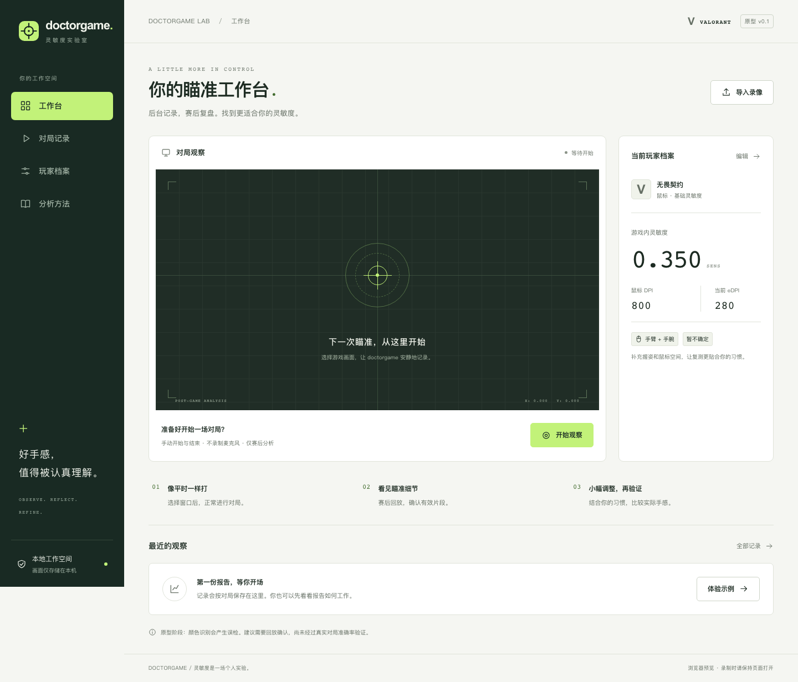
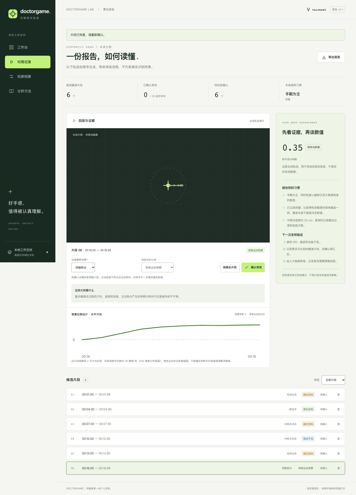

# doctorgame · 灵敏度实验室

项目名称：`doctorgame` · GitHub 仓库：[zhoujoe194-maker/doctor-game](https://github.com/zhoujoe194-maker/doctor-game)。

面向无畏契约的本地桌面原型：后台记录游戏画面，赛后回放瞄准片段，结合玩家习惯提出可复测的灵敏度实验。

doctorgame 希望把「灵敏度不顺手」拆成可回看的具体问题：击杀前是否甩过头、被击杀前是否来得及对准、无击杀对枪中是否反复补拉，以及预瞄时的方向变化与减速过程。玩家的瞄准方式、握姿和可移动空间会帮助解释这些线索，并确定下一次应该复测什么。

**当前交付是可运行原型，不是已经验证有效的灵敏度优化产品。** 尚无真实对局训练数据或准确率评估。自动击杀/死亡识别没有实现，相关场景由用户回放确认。

## 界面预览





## 核心流程

填写玩家档案 → 选择游戏窗口并后台记录 → 赛后提取候选片段 → 按场景回放确认 → 小幅试用或保持原值 → 在相同条件下复测。

## 运行

需要 Node.js 22.12+。支持 npm 或 pnpm。

```sh
npm install
npm run setup:desktop
npm start
```

不安装桌面运行时也可以预览、导入录像或使用浏览器屏幕共享录制：

```sh
npm run dev
```

访问 <http://127.0.0.1:4173>。浏览器录制时必须保持页面打开；桌面版在录制时关闭窗口会隐藏到托盘，可从托盘停止。

Windows 打包命令：

```sh
npm run pack:win
```

运行打包命令后，会生成 `release/doctorgame-win32-x64`，内含未签名的 `doctorgame.exe`。需要将整个文件夹一起分发，不能只复制可执行文件。Windows 真实游戏采集仍需在目标设备验收；当前桌面测试环境为 macOS。

这个源码仓库不包含生成的运行包、依赖目录或玩家录像。项目介绍中的界面图片来自原型和明确标注的合成示例。

打包脚本仅复制运行所需的界面和桌面代码，避免将开发依赖带入安装目录。如果无法访问 Electron 的默认下载地址，可按 Electron 官方安装文档配置下载镜像后重试。

## 已有功能

- 玩家档案：DPI、基础灵敏度、敌人轮廓颜色、手臂/手腕/混合瞄准、趴握/抓握/指握、实际可移动宽度、控制感。
- 手动选择窗口、开始/结束后台录像；不录音。桌面版按块写盘，浏览器版按块写入 IndexedDB。
- 每次录像保存当时的档案；后来修改档案不会篡改旧报告的分析条件。
- 本地赛后逐帧抽样，查找敌人颜色轮廓和目标相对准星的位移。
- 多个背景区域的位移一致性估计，收集预瞄候选片段；方向反转与低频位移速度仅供观察。
- 回放、确认和修改片段类型；按击杀、被击杀、对枪未击杀、预瞄分类和筛选；排除误检后可以恢复。
- 0.5× / 0.25× 慢放，以及包含前后过程的片段回放；按场景显示不同的观察重点。
- 在当前播放位置补充算法漏掉的关键事件，保留前 3 秒和后 1 秒。手动事件只作复盘，不被计作量化样本。
- 对确认的对枪样本提出 ±3% 试验值，或保持原值。握姿用于解释与复测设计，暂不直接改变数值权重。
- 对局列表、JSON 报告导出、取消分析并保留录像、录屏拒绝和无样本恢复路径。
- 合成示例明确标注来源，永远不会被当作真实数据推荐灵敏度。

## 推荐流程

1. 填写实际参数与习惯，颜色与游戏设置一致。选择完整游戏窗口，准星位于画面中央。
2. 点击「开始观察」，正常游戏；对局结束后点击「结束并分析」。目前不自动判断比赛结束。
3. 回放候选片段，确认场景、目标和动作意图。排除压枪、移动目标、观战、技能特效和错误轮廓。
4. 击杀/死亡标签是分析上下文，不能直接代表瞄准好坏。预瞄候选另行观察，不参与当前的数值推荐。
5. 有足够有效样本时，固定 DPI、设备和握姿，交替复测原值与候选值，保留适应时间，观察微调、转身和控制感。

## 工程与算法边界

- 界面采用原生 ES modules / HTML / CSS，桌面使用 Electron，当前无后端服务、云上传或 API 密钥。
- 录像采集目标 1080p / 60 fps，实际由源窗口和系统决定。分析画面缩小为宽 640 px，每秒抽样 20 帧。
- 颜色连通域是实验基线，不是经过训练的敌人检测模型。多个目标、跟踪跳变、低质量采样不计入轨迹。
- 背景块匹配只覆盖小幅画面位移；高速甩枪、低纹理和一致性不足时拒绝给出结果。角色走动、视差、场景切换和后坐力仍会混淆视角运动。不能根据此模块声称测到了鼠标轨迹、手抖或神经肌肉表现。
- 至少 20 个已确认且未排除的对枪片段，某方向占比至少 65%，其 Wilson 下界大于 50%，才给出 3% 试验。**这是未经实证标定的工程规则，不是个体最优值、成功概率或因果结论。** 同一对局中的片段不一定独立。
- 全量视频按时间点 seek 解码，长对局可能处理较慢；允许取消。没有声称分析实时性能或游戏帧率影响达标。
- 当前不分析开镜倍率、击发时机、精确命中率、无轮廓敌人或手部摄像头，也不读写游戏内存、模拟输入或自动更改游戏设置。
- 单次记录到约 1.8 GiB 或 90 分钟自动结束；原型无自动清理。可在桌面版「对局记录」打开录像目录自行管理。
- 桌面录像保存在应用用户数据目录 `recordings/`；报告和档案在应用本地存储。浏览器数据随网站数据清理而消失。原型没有自动同步或备份。

## 验证

```sh
npm test
npx playwright install chromium
npm run test:ui
node tests/electron-smoke.mjs
```

算法测试使用合成轨迹和已知图像位移；界面测试用程序生成的画布视频实际编码、保存、解码和生成报告。它们用于验证软件管线，不代表真实游戏识别准确率。

验收记录见 [docs/validation.md](docs/validation.md)，后续算法和数据设计见 [docs/product.md](docs/product.md)。

## 代码结构

```text
electron/             桌面窗口、托盘、窗口采集与录像文件存储
src/analysis.js       轮廓跟踪、背景位移、玩家习惯和试用建议
src/media.js          视频录制、逐帧分析与合成示例
src/storage.js        本地录像和报告存储
src/app.js            工作台、玩家档案与片段复盘界面
scripts/              本地预览服务与 Windows 打包
tests/                算法、浏览器流程和桌面冒烟测试
docs/                 产品设计、验证记录与 Windows 使用说明
```

## 研究与平台依据

- [NVIDIA / IEEE 的灵敏度研究](https://research.nvidia.com/publication/2023-07_mouse-sensitivity-first-person-targeting-tasks)：研究了第一人称目标获取中速度与精度的取舍，不能据此推导本项目握姿对应的固定最优值。
- [Riot VALORANT 开发者政策](https://developer.riotgames.com/docs/valorant)：区分赛后学习工具与即时改变玩家行为的游戏内反馈，服务玩家的产品有注册要求。当前原型没有获得 Riot 审核；国服发行与兼容性需要单独确认。
- [Electron desktopCapturer](https://www.electronjs.org/docs/latest/api/desktop-capturer)、[MediaRecorder](https://developer.mozilla.org/en-US/docs/Web/API/MediaRecorder)：系统窗口采集和分块录像的实现依据。
