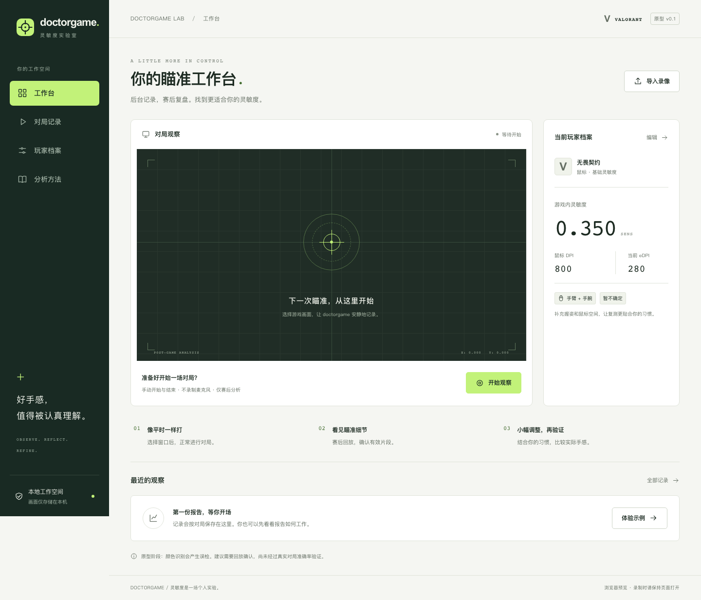
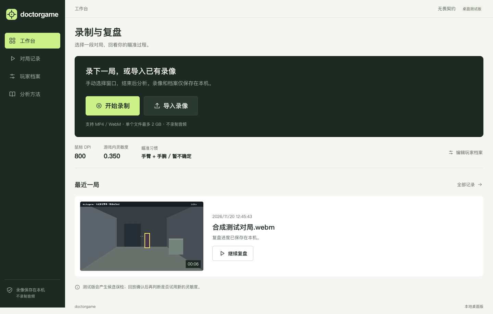
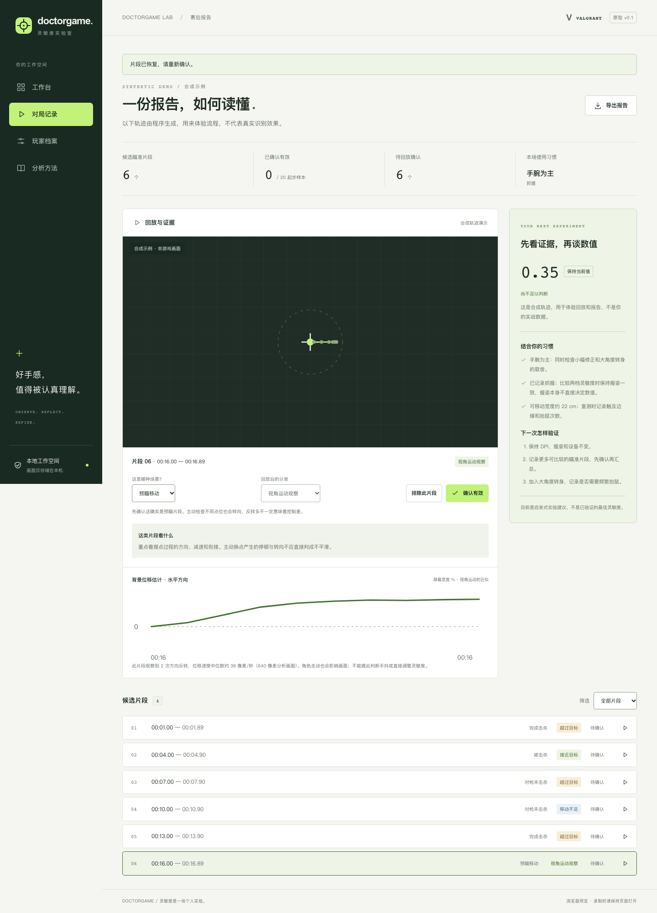
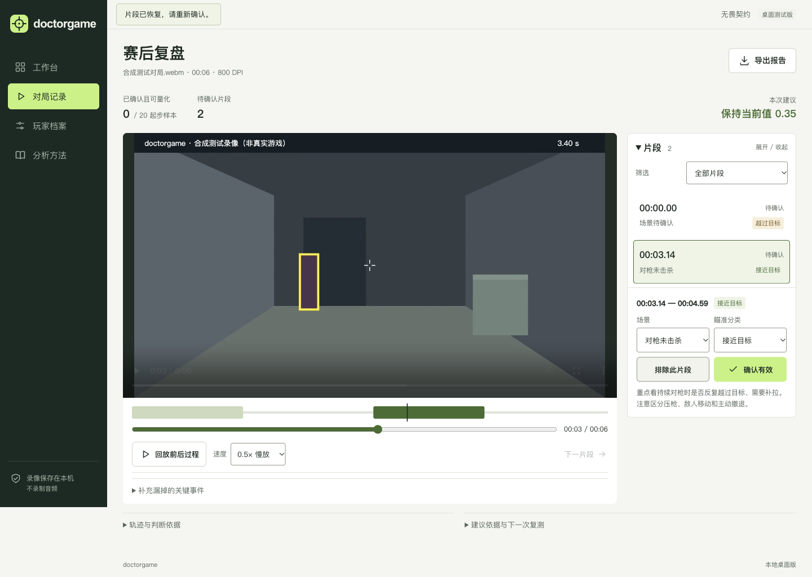

# 桌面测试版验收 · 0.2.0-beta.1

基线 `4d72b917460eddabddf8879b849f28458101269c`，开发分支
`codex/windows-desktop-beta`。2026-11-20，北京时间。
开始时源码工作区干净；原有忽略的截图和测试结果已另外备份，旧 release 产物保留。
已读取 AGENTS 和任务文档，识别全部 9 个项目 skills（包含首批 6 个）。

## 界面前后

改版前为仓库已有浏览器截图；改版后取自本机独立打包的 Electron 应用，
1440×900 内容窗口，完整页面截图。视频是程序生成并带水印的合成录像，非真实游戏。

| 工作台 · 改版前 | 工作台 · 改版后 |
| --- | --- |
|  |  |

| 复盘 · 改版前 | 复盘 · 改版后 |
| --- | --- |
|  |  |

设计参考与取舍见 [界面设计记录](desktop-beta-design.md)。
1280×720、1440×900 和 760×620 均检查无横向溢出；常用桌面尺寸下慢放与确认按钮
完整位于视口内。小窗口片段列表可折叠。确认、排除和恢复不重建视频，不丢失位置及速度。

## 本机已执行

本机 macOS 14.4 arm64；Node 24.22.3、pnpm 11.25.0、Playwright 1.65.1、
Chromium 159.0.8154.6、Electron 45.3.2（Chromium 156.0.8078.100 / Node 24.22.2）。
Node 使用本机已有的 Codex runtime，未修改系统 PATH。

| 命令 / 检查 | 实际结果 |
| --- | --- |
| `pnpm install --frozen-lockfile` | 通过；NSIS 不使用的 Squirrel 依赖安装脚本明确禁用 |
| `pnpm test` | 11 项通过；原样保留算法与样本资格规则 |
| `pnpm run test:ui` | 5 项通过；实际视频编码与导入、片段跳转、慢放、确认/排除/恢复、焦点返回、窗口尺寸、axe 检查 |
| `node tests/electron-smoke.mjs` | 开发 Electron 通过；隔离用户数据，实际文件选择导入、原生写盘和媒体协议回放 |
| 打包 macOS arm64 后，以 `DOCTORGAME_EXECUTABLE` 指向独立程序执行同一冒烟 | 通过；重启保留档案、录像和报告；旧录像仍保留当时 800 DPI，当前档案改为 1600 DPI 不篡改旧数据 |
| Windows x64 运行目录 | 74 个文件，PE AMD64 入口，ASAR 白名单检查通过 |
| `python3 scripts/verify-steam.py` | 合成目录的 21 个禁止文件全部排除；实际 74 个运行文件与安装器输入逐文件 SHA-256 一致；0 错误 / 0 警告 |

Electron 的 contextIsolation / sandbox 均开启、nodeIntegration 关闭，渲染器无 `require`。
原 `src/analysis.js`、`src/media.js`、`src/storage.js` 未改动，存储标识和建议阈值保持兼容。
测试使用合成素材，仅证明工程流程，不证明真实检测准确率或灵敏度改善。

## Windows 安装与下载

Windows CI 配置在 `.github/workflows/windows-beta.yml`。它生成版本化未签名 NSIS 安装包，
并通过 `scripts/test-windows-install.ps1` 执行实际安装、开始菜单启动、UI 导入复盘、
重启、测试版本升级及卸载保留数据。安装后程序的 PATH 移除 Node / pnpm，独立运行。
CI 的成功状态与下载校验值将在本次实际运行结束后记录于此。

本机默认官方下载请求发生 `UND_ERR_CONNECT_TIMEOUT`；使用已有 Electron ZIP 缓存后
运行目录构建成功。macOS 本身无法执行 Windows 安装器；不能把交叉打包等同于安装验收。

## 仍需 Windows 游戏硬件

- Windows 10/11 x64 交互式安装器界面、高 DPI 和多显示器；未签名包的系统提示。
- VALORANT 窗口选择、取消、拒绝权限恢复、全屏/无边框/窗口模式、托盘录制与停止。
- Vanguard 兼容性、90 分钟/约 1.8 GiB 自动停止、低磁盘及意外退出后的录像保留。
- 游戏 FPS、录制帧率与丢帧、CPU/GPU/内存/磁盘使用；在真实玩家录像上评估检测准确率。

Steam 仅完成离线映射，模板占位符未改写；没有登录、Steam Preview、上传、付费或 SetLive。
实际发布和商店资格仍由发布者另行决定并接受 Valve 审核。
