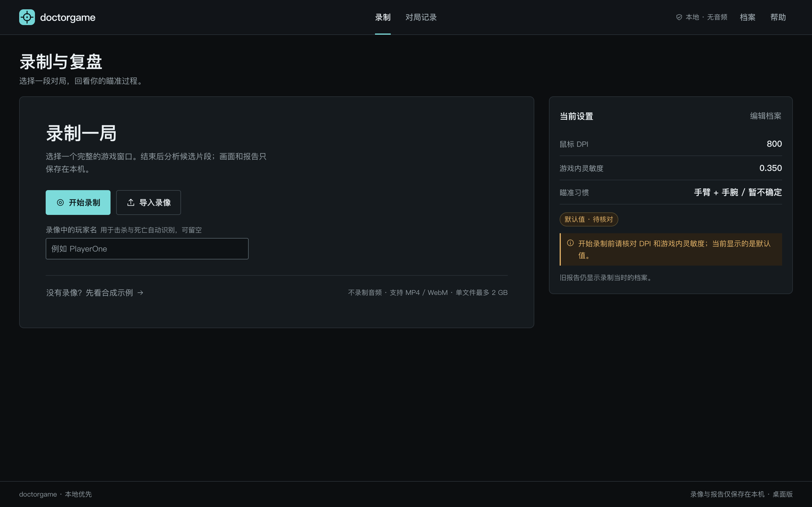
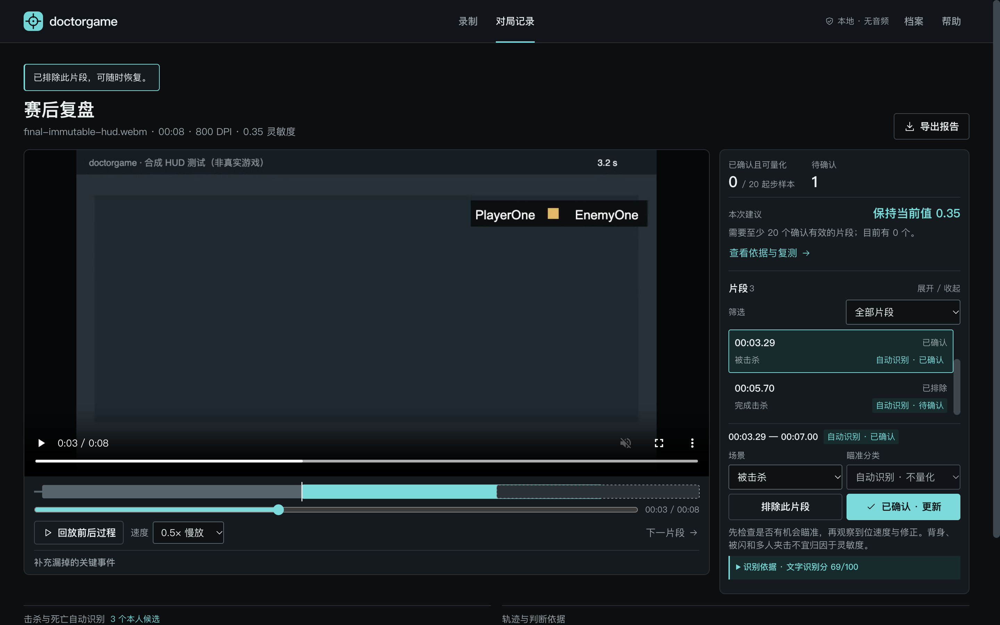

# 整段录像自动事件识别 · 独立验收

2026-11-22 首轮，2026-11-23 追加 Windows 去重验收；负责人 Codex，DSH 实现。任务 [#6](https://github.com/zhoujoe194-maker/doctor-game/issues/6)，
草稿 [PR #4](https://github.com/zhoujoe194-maker/doctor-game/pull/4)，未合并。

## 交付范围

基线应用 `2cf4ee414c0c61f91ccfa11215322c6a51c63a16`，停止自动打包 `2e5e941`。
DSH 实现 `09604fc` → 独立验收退回修复 `24467f6` → 编号边界修复
`c74c32f77f17d097e078cfc93b37ecde420c9d3a`；Windows 独立复核后追加参与者去重修复
**`01610c1a9983a06fcaebf438e13bc31a17de3b49`**。
保留前轮尚未提交的 UI 验收文档、录像库截图及所有旧安装产物；没有重置用户数据。

原版本已经对完整录像执行轮廓/背景运动抽样，自动生成瞄准候选，不要求用户先裁剪。
本轮增加本机 OCR：填写录像中显示的玩家名后，扫描右上击杀信息，按参与者位置生成本人击杀/死亡候选，
去重并保留前后过程；点击片段跳转源录像、慢放、确认或排除。不导出独立裁剪文件。
没有名字仍可导入，之后在该报告补填并重新识别。没有实现自动判定“对枪未击杀”。

保持整段 20 fps 轨迹抽样，另加 1 Hz 事件扫描和附近细读；**尚未把整个管线改成只分析关键区域的高速流水线**。
长录像可导入、可取消，但完整长局吞吐未量测，不能由 8 秒视频推算。
所有自动语义事件均不量化，只有原有可量化轨迹经回放确认才可能进入原建议规则；阈值和 ±3% 未改。
设计、资源来源、许可证、固定版本及限制见 [检测说明](event-detection.md)。

## 负责人发现并退回的问题

| 问题 | 之前实际卡点 | 修复后的完成方式 | 验证 |
| --- | --- | --- | --- |
| 玩家身份误认 | `AlexB Enemy` 被当作 `Alex` 的击杀 | 精确归一化参与者匹配；不任意裁掉名字后缀 | 实际 Node 复现；AlexB/Alex1/Alexll 拒绝回归；真实 OCR 合成视频仍能检出 |
| 长录像事件合并 | 全局倒序细扫把 1.8 秒事件并到 22.6 秒同名事件 | 指定单个事件细读，独立时间边界，at 与 firstSeen 一致 | 2.6/22.6/42.6 秒三次同名的完整粗扫/细扫单元回归 |
| 重扫失败丢进度 | 实际 Electron 将资源协议置 404 后，3 个旧候选变 0，已确认丢失 | 错误只提示，不持久化空结果；成功重扫保留确认/排除，身份变化保留旧候选供审查 | 修复后同样 404，原 localStorage 报告字符串完全不变；确认/排除重扫保持 |
| 跨身份重扫编号冲突 | 新、旧事件都叫 hud-1，下一次可能错配 | 匹配沿用旧 ID，新事件避免碰撞，旧身份确认可以恢复 | Alex→Bob→Alex 回归；UI 重扫唯一 ID 断言 |
| 进度/文案误导 | 进度从近 100% 退到 55%；已确认仍写待确认，OCR 分数像准确率 | 阶段单调进度；自动事件状态正确；文字识别分移入折叠依据，说明不是事件准确率 | 浏览器进度断言；实际 Electron 截图，1280×720 操作首屏 |

## 实际桌面路径

macOS 14.4 arm64，命令行 Node 24.22.3，Electron 45.3.2 / Chromium 156；
正常 `sandbox:true / contextIsolation:true / nodeIntegration:false`，隔离 user-data。
DSH 环境无法启动 Electron，由负责人实际桌面环境补验，没有使用 no-sandbox。

固定测试文件 `artifacts/event-audit/final-immutable-hud.webm`，8.196 秒，1280×720，画面明确标注合成、非真实游戏；
SHA-256 `0bc9c904e5c2bfcbb27c2b0015b679fe7905fdac6b25bffdbc8126f5550a5249`。
文件从 fixture 复制后冻结，避免同时运行浏览器 suite 重新生成同一路径影响读取。

| 玩家目标 | 实际操作和结果 |
| --- | --- |
| 整段导入后自动挑片段 | 首页填 PlayerOne → 导入整个 WebM → 实际 seek 解码与本地 OCR → 3 个事件（击杀/死亡/击杀），无需标记时间；23 次 OCR，OCR 阶段 2821 ms，起点 at 为 1.6/4.8/7.2 秒。只有合成工程意义，不是实战精度或速度结论 |
| 看懂并复盘 | 点击第二片段 → 跳到含前余量的 3.3 秒 → 实际播放/暂停，readyState=4、error=null → 0.5× → 确认死亡 → 排除第三片段；仍 0/20 量化样本，保持 0.35 |
| 小窗口完成操作 | 1280×720 下视频底部 556.09 px，慢放 653.09 px，确认/排除 688.77 px；均在首屏 |
| 重新识别 | 同身份重扫，第二项确认、第三项排除均保留；c74c32f 再次重扫通过、ID 唯一；模拟 OCR 资源 404 时原报告字符串不变 |
| 重启后继续旧局 | 当前档案改 1600 DPI 和 NewPlayer → 关应用 → 重启 → 继续复盘；原报告逐字不变，仍 800 DPI / PlayerOne，确认/排除保持，录像能继续播放 |
| 离线与安全 | 请求记录只有 file/blob/doctorgame-asset，本次无 HTTP(S)；12 项本地资源逐项 SHA-256/大小校验通过；OCR 通过受限只读协议，不给 renderer Node 权限 |

重启证据在 `artifacts/event-audit/restart-evidence.json`；导入/已复盘报告、失败前后报告、截图保存在相同目录。
首轮读取一个正在被其他测试重新生成的 fixture 曾出现播放错误；冻结副本后实际播放正常，不把测试文件竞争当作产品修复。

## 界面证据

首次使用与复盘截图来自 24467f6，c74c32f 仅调整 ID/清理状态，无视觉改动；重启截图来自 c74c32f。
同尺寸旧版与新版的六组对比、首次/回访/录制三状态见 [全界面验收](full-ui-validation.md)。

[1280×720 复盘](images/event-detection/report-1280.png) · [重启继续](images/event-detection/restarted.png)

## 最终命令与结果

- `npm test`：c74c32f，26/26 通过。
- `npm run test:ui`：c74c32f，24/24 通过（2.7 分钟）；含 5 项真实 OCR/媒体/复盘回归。
- `DOCTORGAME_TEST_LABEL=hud-delivery node tests/electron-smoke.mjs`：c74c32f，正常 Electron 通过导入/复盘/持久化/重启/缩放。
- `node tests/electron-hud-smoke.mjs`：负责人将独立交互验收固化为源码桌面回归，本机通过真实 OCR/三个候选/0.25×实际播放/确认排除/重扫/重启/文件 SHA 与档案保留，拒绝越界资源路径；无 HTTP(S) 请求。该次新生成合成文件的 OCR 阶段为 2676 ms，结果在 `artifacts/electron/hud-source/result.json`，已接入 Windows 源码 CI。
- `git diff --check`：通过；`.agents` 与 `skills-lock.json` 对技能分支 diff 为空。
- Python 校验 `assets/ocr/resource-manifest.json` 的 12 个文件：大小与 SHA-256 全部匹配。
- Windows 源码 CI：以 [PR #4 的最终 CI 回执评论](https://github.com/zhoujoe194-maker/doctor-game/pull/4) 中的运行链接与 SHA 为准。包含上述真实桌面 OCR 回归；安装器任务保持关闭。

## 如何体验和尚未验证

### 2026-11-23 Windows 差异复核

`c5049b7` 的 [Windows 源码 CI](https://github.com/zhoujoe194-maker/doctor-game/actions/runs/45011980195)
通过 26 算法、24 UI（4.4 分钟）、两个实际 Electron 流程，安装器任务为 **skipped**。
但负责人读取日志和下载证据后发现：桌面合成的三次事件产生了 **4 个候选**（28 次 OCR，6092 ms），
当时 smoke 只要求存在 kill/death，未拦住重复。这一轮绿色 CI 不能当作去重正确的证据。

负责人另复现：同一行的中间图标被 OCR 成 `EM`/`I`，整行签名变化会产生重复事件。
DSH 在 `01610c1` 改成依据词框分离两端参与者，中间图标只保留为原始证据、不进入去重 key；
精确匹配玩家名不放宽，不同对手仍独立，不能分离边界则拒绝。
桌面验收收紧为三个事件按顺序/相对时段一对一匹配；在断言前保存完整报告供 Windows 失败时追查。
负责人在 `01610c1` 复跑 `npm test`（27/27）、`npm run test:ui`（24/24，2.7 分钟）与
`node tests/electron-hud-smoke.mjs`（通过，3 个候选、23 次 OCR、2887 ms）。完整报告的参与者分别为
PlayerOne/EnemyOne、EnemyTwo/PlayerOne、PlayerOne/EnemyThree；中间图标 EM/I 独立保存，不进入 key。
后续最终运行的 SHA 与结果见 PR #4 最终回执评论；本轮仍不生成安装包。

当前分支 `codex/player-experience-review`，已有依赖的本机在项目目录运行 `npm start`。
隔离体验可运行 `npm start -- --user-data-dir=/tmp/doctorgame-preview-events`（macOS 示例）。
首页填写录像中实际显示的玩家名，导入 MP4/WebM，等待分析后点击候选。
旧报告可以在底部“击杀与死亡自动识别”补填当局名字；它不会用当前档案静默替换录制时设置。

本轮停止点之后没有生成或更新安装包。现有安装包不含此自动识别功能；PR 只跑源码测试，
以后用户明确要求打包才手动设置 `build_installer=true`。不发布 Release、不上传 Steam、不合并 PR。

仍需真实录像验证：真实中英文名 OCR、旁人/助攻/观战/遮挡误检、HUD 缩放/比例、事件召回率、边界误差和长局耗时。
中文语言模型已随项目本地提供，中文 parser 测试通过；没有中文真实游戏视频准确率结论。
需要授权录像与人工标签，并按玩家/对局划分开发和留出测试；报告匹配窗口、分母、拒绝样本和确认负担。
Windows 游戏窗口/全屏、Vanguard、CPU/GPU/FPS、长时间录像必须在 Windows 游戏硬件实测；Windows runner 的源码测试不能代替。
将来授权打包时，还要单独验证安装包中的 OCR 资源和协议。
