# 全界面改版 · 负责人独立验收

2026-11-22（Asia/Shanghai）。任务 [#5](https://github.com/zhoujoe194-maker/doctor-game/issues/5)，
草稿 [PR #4](https://github.com/zhoujoe194-maker/doctor-game/pull/4)，等待用户产品评审后再决定合并。

## 基线与交付

- 本轮开始已 fetch 核实 `codex/player-experience-review` 的本地和远端均为
  `aab91be13ac54afb5af03ae8d78b737dcb4ea444`，工作区干净。继续现有草稿 PR，保留旧截图、录像和安装产物。
- DSH 实现链：`ac78ae5` → `9ba7e3e` → `70db0b9` → `8ef1859` →
  **`4ccf32cdb44a9c39576d4fedac7f7f780a983bfa`**（最终应用源码）。
- DSH 接单回执包含 cwd、分支、SHA、12 个项目 skills 及实际读取说明。
  `.agents` / `skills-lock.json` 与 `origin/codex/doctor-game-skills` diff 为空，无须额外安装。
- 负责人独立更新三个 Electron 测试的导航/标题定位，保留原任务断言，增加 1280×720 控件首屏检查。
- `src/analysis.js`、`src/media.js`、`src/storage.js`、Electron、安全设置、依赖和推荐阈值均未改。
  旧报告读取防护在 UI 边界进行；不迁移、不删除、不静默重算报告。

## 设计依据与最重要的发现

参考 [Aimlabs 官方 Play 主界面](https://clan.fastly.steamstatic.com/images/30632227/427b1222a6b90572175d155eef402bb8c502ce14.png)
的横向导航、内容缩略图与进入动作的位置关系，及
[官方结果页](https://clan.fastly.steamstatic.com/images/30632227/061487196be8880f4f28cd7e0ed1cdc7e217b15c.png)
的视频与片段组织。保留 doctorgame 品牌、中文、用户指定的深灰青色系，无 Aimlabs 商标或无关功能。
具体设计见 [设计说明](full-ui-design.md)。

| 优先问题 | 之前卡在哪里 | 现在怎样完成 | 独立验证 |
| --- | --- | --- | --- |
| P1 旧报告损坏使首页无法启动（改版中发现的回归） | `recommend()` 失败后读取 `null.reviewed`；隔离报告 `profile.dpi=0` 可复现停在启动占位 | 显示“报告无法读取”，不伪造 0/20；仍可导入、录制、访问其他记录；点击坏报告不进入半渲染页面 | 退回 DSH 后，打包版实测非法 DPI、`events:null`、坏 JSON 三种情况；原报告字符串、录像 SHA-256 和 JSON 元数据保持；另一份真实导入报告仍可打开 |
| P2 首屏和导航挤占玩家任务 | 190px 固定左栏、左右重复上一局、重复页标题；档案保存入口在长表单底部 | 顶部导航；首访录制/导入和设置核对相邻；回访由上一局画面和“继续复盘”主导；档案保存并返回录制 | 相同数据/1440×900 对比；1280×720 继续按钮完整可见；实际保存返回及重启继续 |
| P2 复盘操作离画面远、字过小 | 统计横行把视频推下；900px 高度慢放靠底，改版首稿部分说明仅 10–11px | 视频左、片段检查器右；建议原因就近；慢放、确认、排除首屏可达；操作 14px、标签至少 12px、原因 13px | 1440×900、1280×720 实际 Electron 控件完整在视口；实际计算字号；760×620 可滚动，200% 原生缩放无横向溢出 |

## 四条玩家路径

测试用独立 user-data，不操作用户真实录像。两轮都使用相同的 6 秒合成 WebM：
`SHA-256 9bd7c41345a6f8d72e5e69b0db7c32b0d579a092b0367493eb5272d1a5e75c89`。
画面有“合成测试录像（非真实游戏）”标记；测试中的样本数字仅验证软件管线，不是玩家表现证据。

| 玩家目标 | 实际操作 | 预期结果 | 实际结果与证据 |
| --- | --- | --- | --- |
| 首次使用并确认参数 | 隔离数据启动 → 编辑档案 → 核对 800 DPI / 0.35 → 保存并返回录制 → 导入文件 | 默认值明确待核对，填完回到原任务 | 通过；首访无空视频占位，设置与主操作可见；`first-use.png`、`profile.png`、`audit.json.profileAfterSave` |
| 录制完整一局 | 显式合成窗口选择 → 真实 MediaRecorder 录制 → 最小化/恢复 → 切到档案 → 关窗隐藏/返回 → 跨页结束并分析 | 随时知道是否在录，停止后有可播放录像 | 通过；真实 Electron IPC/文件写入、原生窗口状态；`recording.png` 和零候选报告。画面源及窗口枚举由明确的 canvas adapter 提供，不是系统游戏采集 |
| 取消或被拒后重试 | Escape 取消选窗；adapter 抛 `NotAllowedError`；重试选择有帧画面 | 焦点回到开始录制，拒绝不锁死；无帧有取消/超时出路 | Electron 取消/拒绝/重试通过；浏览器回归覆盖无帧取消、8 秒超时、无空录像、恢复。未实际撤销 macOS/Windows 系统权限 |
| 复盘一局 | 导入 → 点第二候选 → seek → 0.5×/0.25× → 选择对枪 → 确认 → 排除/恢复 → 查看原因 | 跳到片段、播放位置与速率不被确认打断，计数和原因一致 | 通过；保持原值 0.35，原因是有效样本不足；`report.png`、`report-1280.png`，packaged smoke 还检查键盘确认及播放器节点未重建 |
| 没找到片段或中止分析 | 合成空场景分析 → 零候选；再次导入 → 取消分析 → 记录中重试 | 完整录像保留，有手动复盘入口 | 通过；零候选能播放/标记/导入，手动标记仍不量化；取消后重试生成报告；`zero-candidates.png` |
| 再次打开继续 | 一项确认、一项排除 → 当前 DPI 改 1600 → 重启 → 继续旧报告 | 原文件、报告和当局参数保留 | 通过；录像 hash 和报告字符串完全一致，当前为 1600 DPI，旧报告和录像快照仍为 800 DPI；`returning.png` |

## 同尺寸前后截图

全部来自负责人实际 Electron。首访是未确认默认档案；回访是同一文件、1 个已确认片段与 1 个已排除片段；
录制是相同 canvas 场景、相同 1440×900 内容区。时间戳/系统生成 ID 随独立测试不同。
历史 beta.1 的第一轮对比另保留在 [上一轮验收](player-experience-validation.md)，此处不冒充 beta.1。

| 状态 | 改版前 aab91be | 改版后 4ccf32c |
| --- | --- | --- |
| 首次打开 | 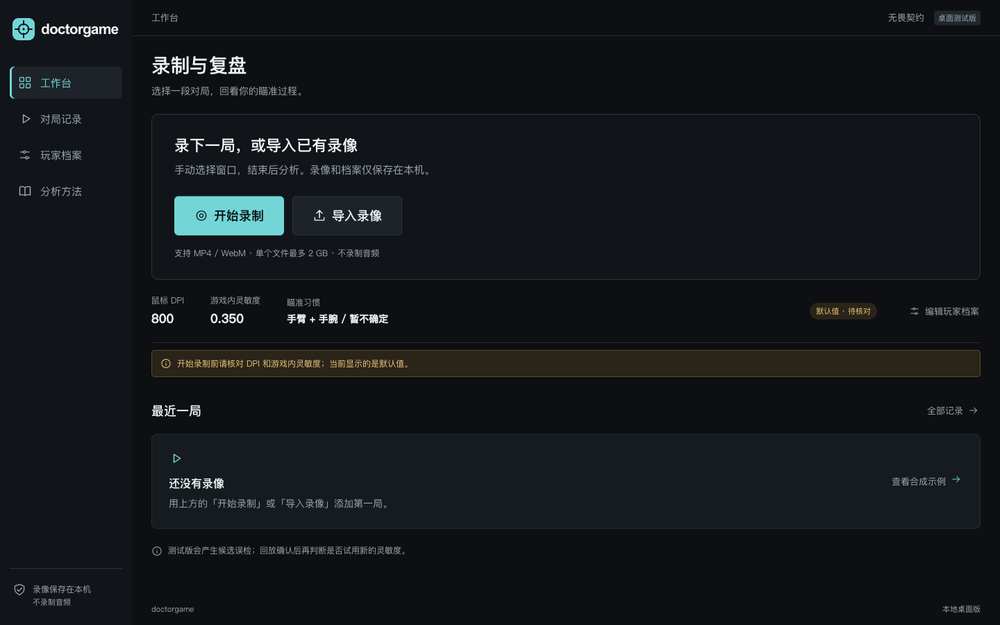 | 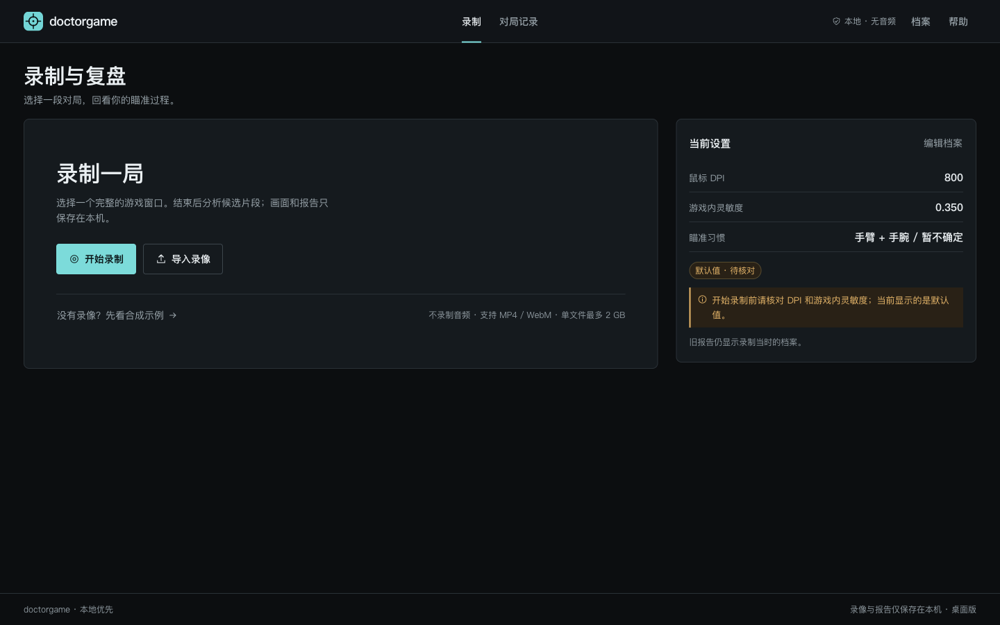 |
| 继续上一局 | 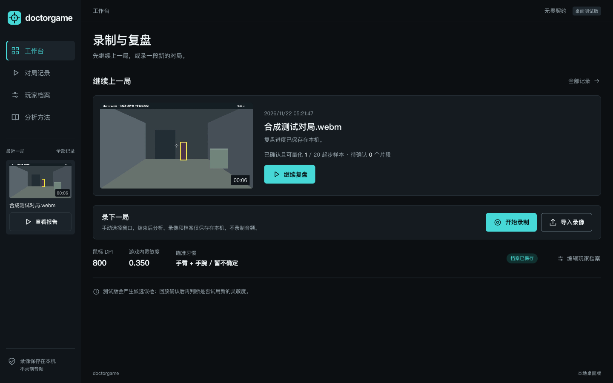 | 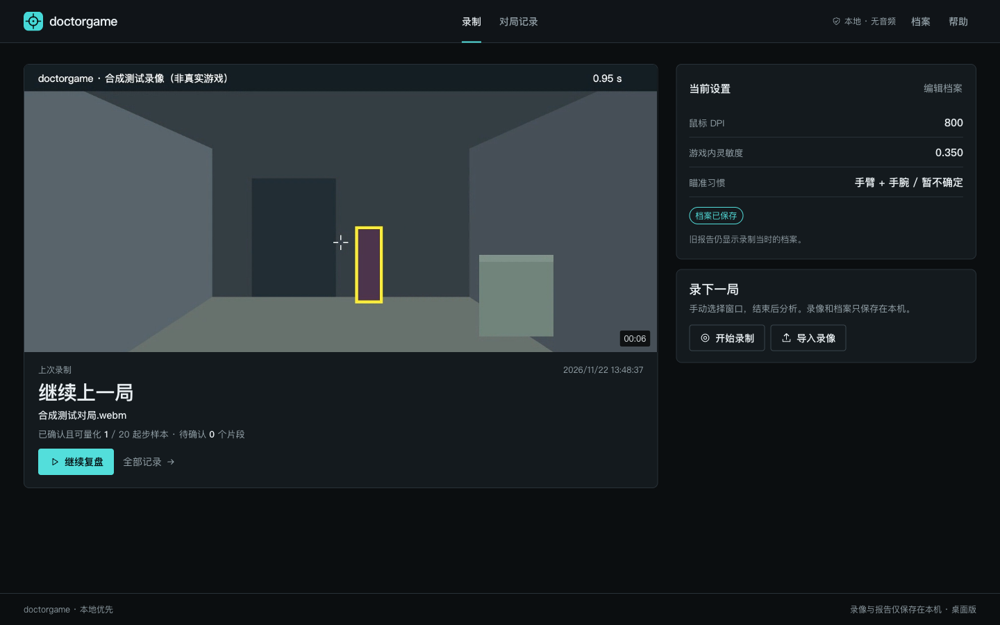 |
| 正在录制 | 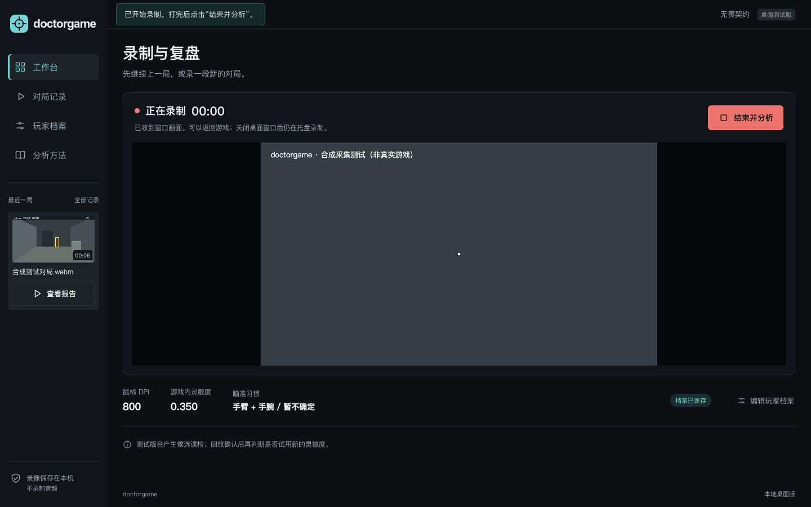 | 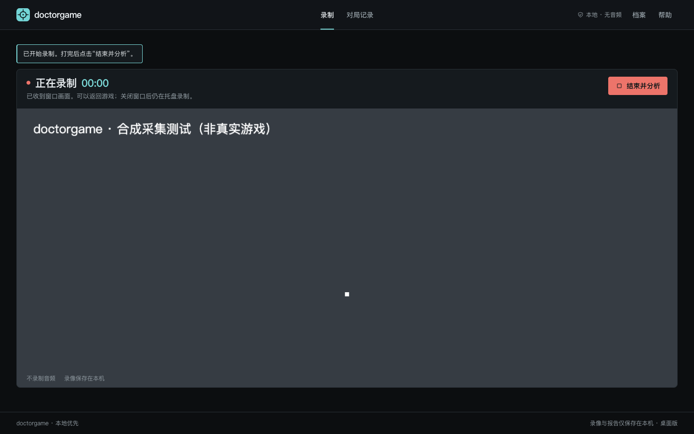 |
| 赛后复盘 | 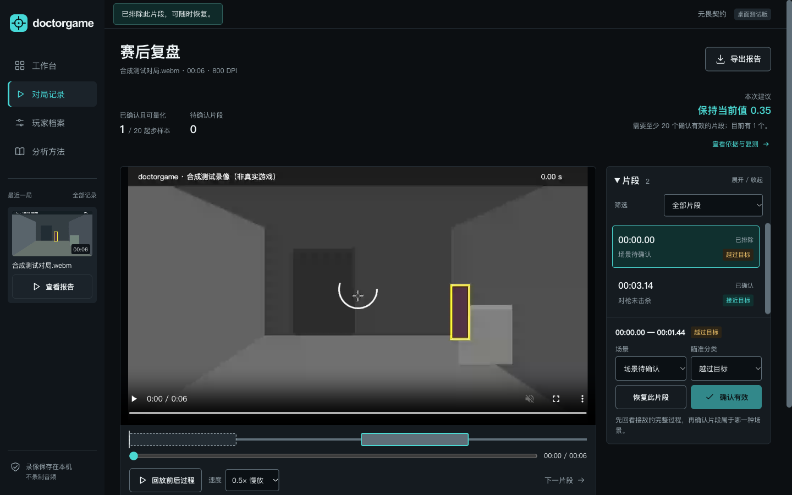 | 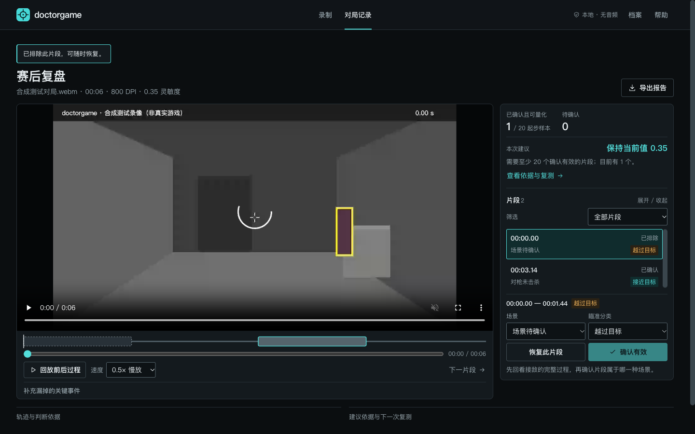 |
| 玩家档案 | 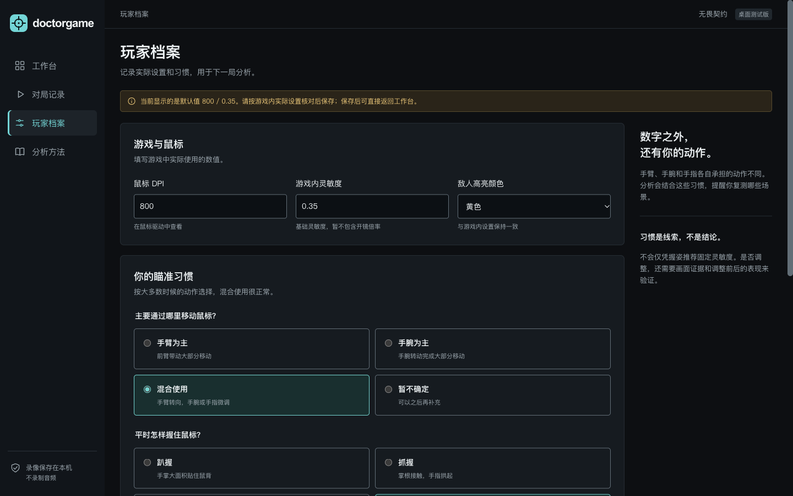 | 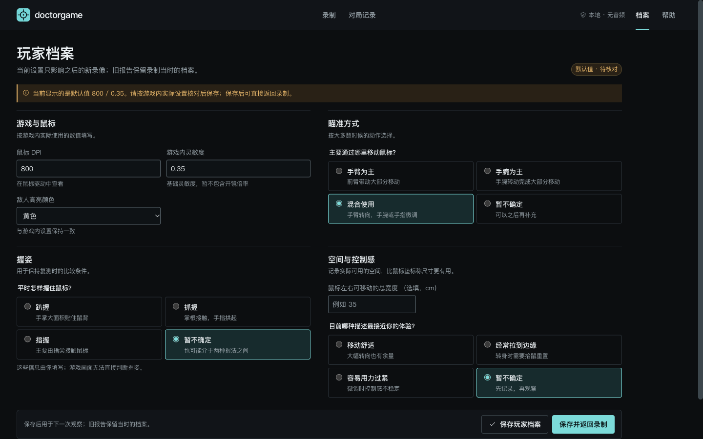 |
| 帮助说明 | 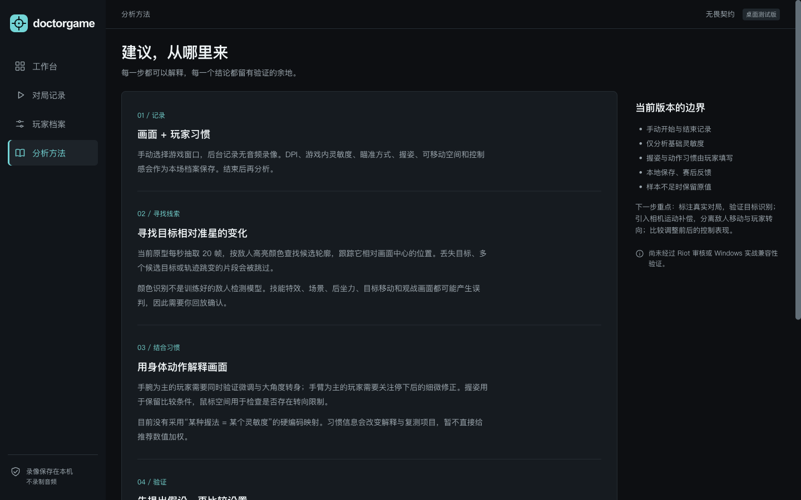 | 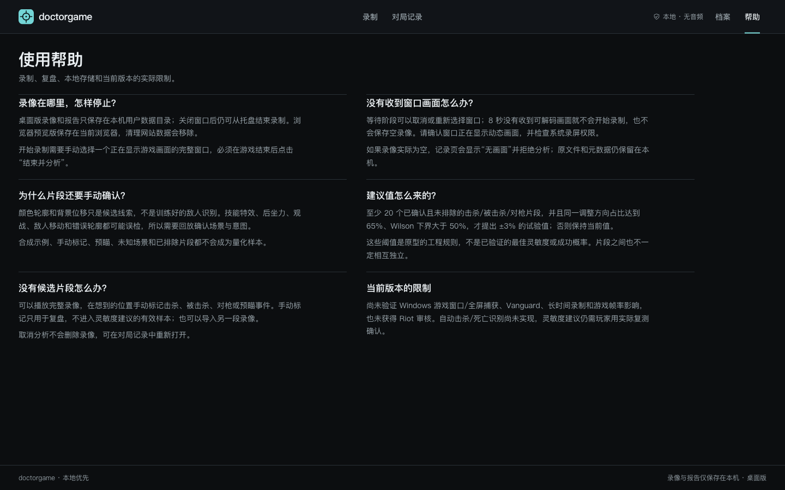 |

另有打包版实际播放后暂停的[稳定视频帧截图](images/full-ui/after/report-stable.png)、
[1280×720 复盘](images/full-ui/after/report-1280.png)、[零候选](images/full-ui/after/zero-candidates.png)、
[选窗](images/full-ui/after/source-dialog.png)、[最小窗口](images/full-ui/after/minimum-window.png)、
[200% 缩放](images/full-ui/after/zoom-200.png)。原生播放器在刚 seek 时可能短暂显示加载动画；
稳定帧截图通过实际播放和暂停取得，未编辑视频或截图。

## 本轮独立执行

macOS 14.4 arm64；Node 24.22.3（命令行），Electron 45.3.2；采用正常 sandbox，
并核对 `contextIsolation:true / nodeIntegration:false / sandbox:true`。DSH 自测的环境限制不替代下列结果。

| 命令 / 检查 | 实际结果 |
| --- | --- |
| `npm test` | 11/11 通过；原有样本资格和 ±3% 规则未改 |
| `npm run test:ui` | 18/18 通过；含 axe、键盘、真实编码/解码、无帧恢复、列表缩略图和坏报告边界 |
| `AUDIT_LABEL=full-ui-before node tests/player-flow-audit.mjs` | 改版前实际运行通过，保存相同流程基线 |
| `AUDIT_LABEL=full-ui-final node tests/player-flow-audit.mjs` | 最终 4ccf32c 通过；四条路径及 1280×720 首屏操作 |
| `DOCTORGAME_TEST_LABEL=full-ui-final node tests/electron-smoke.mjs` | 正常 sandbox 开发 Electron 通过；另以下行最终打包版为交付依据 |
| `node scripts/package.mjs --platform=darwin --arch=arm64 --version=0.2.0-beta.1-review.4ccf32c` | 构建成功，使用本机可信 Electron ZIP 缓存，旧产物保留 |
| `DOCTORGAME_EXECUTABLE=<review app>/Contents/MacOS/doctorgame DOCTORGAME_EXPECTED_VERSION=0.2.0-beta.1-review.4ccf32c DOCTORGAME_TEST_LABEL=full-ui-packaged node tests/electron-smoke.mjs` | 打包后应用通过导入、解码、跳转、慢放、键盘确认、排除/恢复、三种窗口、重启保留及实际 200% 缩放 |
| `DOCTORGAME_RECOVERY_LABEL=full-ui-final node tests/electron-recovery.mjs` | 通过；实际非空 268880 字节文件 + 陈旧 bytes:0/status:recording 元数据可恢复；原文件和 JSON 不变 |
| 打包版独立交互补验（Playwright Electron） | 三种坏报告、另一份正常报告、原文件 SHA/元数据、14/12/13px 实际字号、760×620、200% 缩放、选窗 Enter/Escape 焦点通过 |
| `git diff --check` / skills lock diff / 核心与安全文件 diff | 通过；12 skills 与 skills 分支一致，算法/存储/采集/安全实现不变 |

本机 Node 入口需把 `/Users/joezhou/.cache/codex-runtimes/codex-primary-runtime/dependencies/node/bin`
加入 PATH。原始产物在 `artifacts/player-experience/full-ui-final/`、
`artifacts/electron/full-ui-packaged/`、`artifacts/electron-recovery/full-ui-final/`。

## 如何体验与剩余事项

Mac 本地评审应用：
`release/0.2.0-beta.1-review.4ccf32c/doctorgame-darwin-arm64/doctorgame.app`。
使用单独 `--user-data-dir` 启动可以隔离体验数据；不需要开发服务器。
Windows 评审安装包由本轮 PR CI 构建并验收，下载入口和 SHA-256 在 CI 完成后追加。
当前 README 中的上一轮包仍是旧布局，不应当作本轮新版。

- 本轮没有 Windows 游戏硬件。真实 VALORANT 窗口/全屏采集、Vanguard、长录制及 FPS/CPU/GPU 开销仍待实机。
- Electron 窗口最小化/隐藏/恢复实际执行；系统托盘菜单未进行真实鼠标点击验收，跨页停止通过应用按钮。
- 少量合成录像的列表预览通过；大量长录像的 I/O/内存压力未量测。
- 损坏报告被保留并明确提示，当前不提供自动修复；可通过录像文件夹取回原始视频。
- Windows 安装、升级证据与 Windows 游戏捕获证据分开；打包成功或合成测试不证明真实识别和灵敏度改善。
- 不创建正式 Release、不上传 Steam、不合并 PR。
