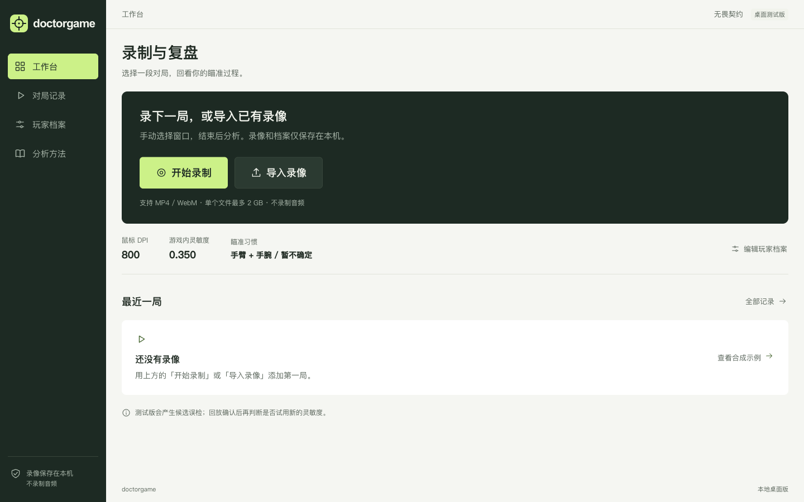
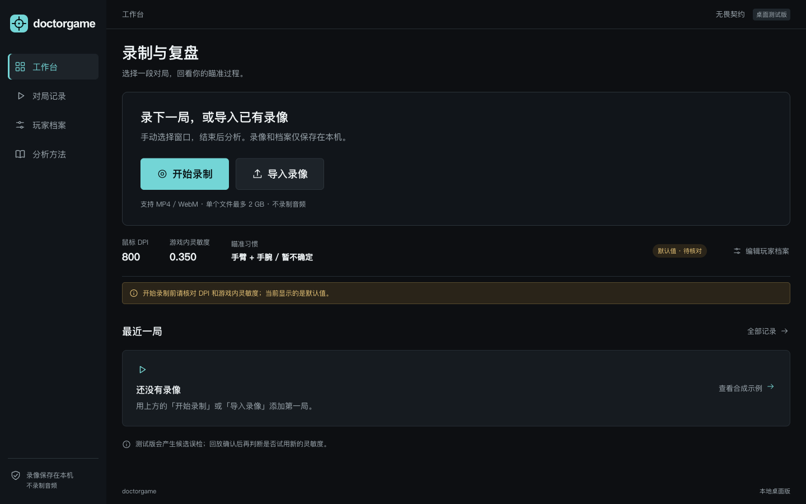
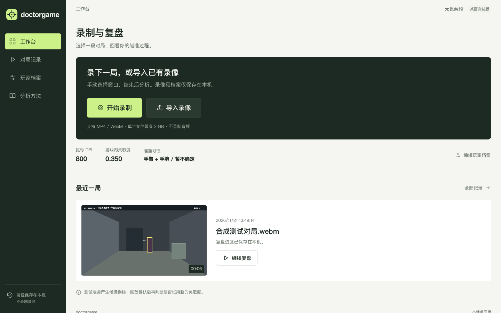
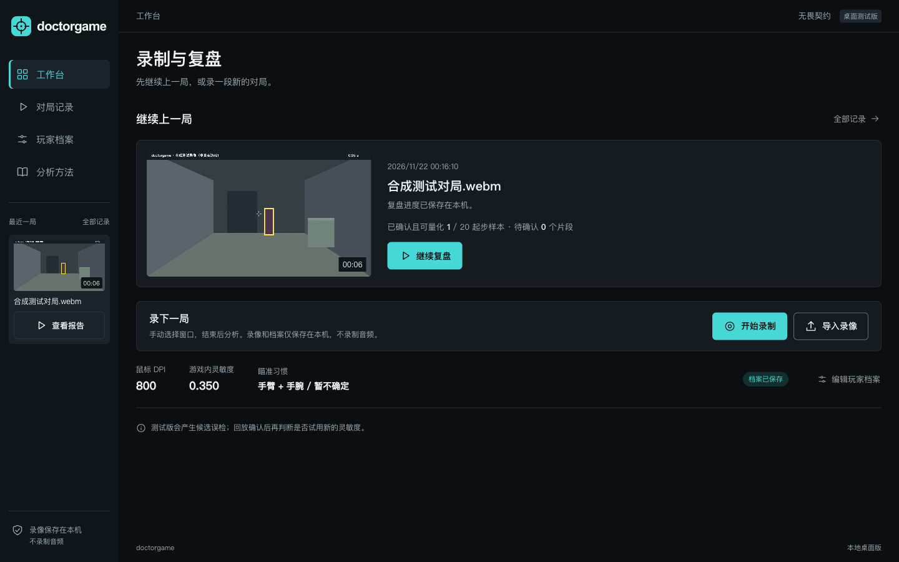
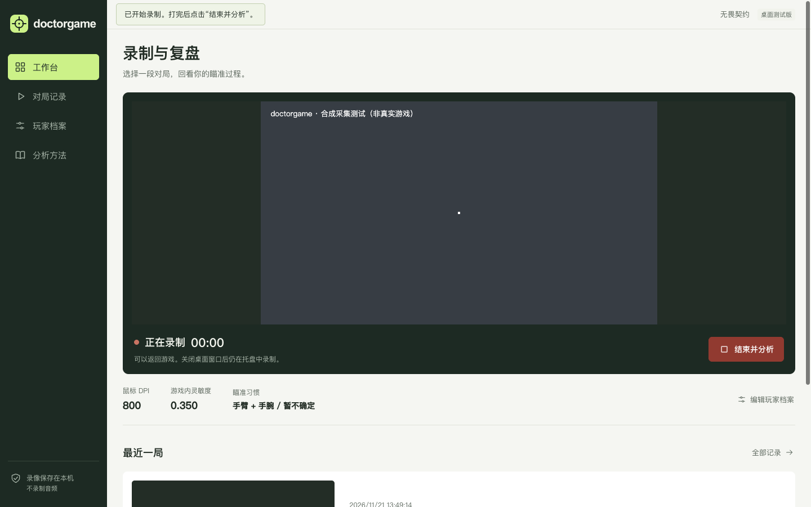
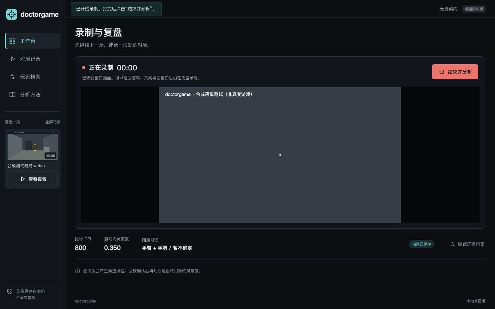

# 玩家体验独立验收

最终验收：2026-11-22（北京时间）。[任务单 #3](https://github.com/zhoujoe194-maker/doctor-game/issues/3)。
Codex 负责规划、亲测、退回和独立验收；DSH 实现；用户评审后决定合并。

## 版本与交付边界

- 应用基线：PR #2，`14d2a0989b2953fdd0fd275e359978af26573b04`，`0.2.0-beta.1`。
- 本轮分支：`codex/player-experience-review`，从该桌面版建立；没有合并到主分支。
- DSH 首次实现：`d5b46cd009bcb58b8e4d2de9e8bc54264ef81a60`。
- 独立审查发现并退回的中断录像恢复修复：`6df62e8819f5b493844ba42fa0279d148adafd73`。
- 最终主题及图标交付：`a4b3c06a81562e62f71175d1c2a67ec58a4fd3bc`；随后负责人仅补验收文档、截图和审查驱动。
- 本地 macOS 预览包：`0.2.0-beta.1-review.a4b3c06`，是本轮评审产物，不是新的正式发布。

用户追加决定：页面与 Aimlabs Play 同色系，覆盖本轮早先“保留森林绿”的要求。
最终为炭黑/深灰表面、青蓝操作色、浅色文字，保留 doctorgame 准星标识和中文。
参考来源及具体布局任务映射见 [DSH 设计记录](player-experience-design.md)。

## 三组前后对照

均为负责人实际 Electron，1440×900 内容窗口、100% 缩放。首访为空数据；回访使用同一
6 秒合成 WebM、800 DPI / 0.35、第 2 片段确认且第 1 片段排除；录制使用同一带水印 canvas
测试适配器，00:00 状态。日期及系统分配 ID 随运行变化，不作为视觉比较依据。
录像 SHA-256：`9bd7c41345a6f8d72e5e69b0db7c32b0d579a092b0367493eb5272d1a5e75c89`。
截图前等待视频加载和跳转完成；视频没有染色。截图不能证明真实游戏采集成功。

| 状态 | beta.1 基线 | 本轮交付 |
| --- | --- | --- |
| 首次打开 |  |  |
| 已有上一局 |  |  |
| 正在录制 |  |  |

[1280×720 回访前](images/player-experience/before/returning-1280.png) / [回访后](images/player-experience/after/returning-1280.png)。

## 优先问题逐项验收

完整的「玩家目标、实际操作、预期、实际、问题与证据」基线在 [亲测记录](player-experience-audit.md)。

| 问题 | 之前卡在哪里 | 现在怎样完成 | 负责人验证 |
| --- | --- | --- | --- |
| P1 无帧仍称录制成功 | 本机原生采集 live track 但 0 帧，停止后空文件仍称可分析 | 第一帧前显示等待；可取消/重选；8 秒无帧退出并不创建空录像；真空文件保留但拒绝分析 | 原生 macOS 合成窗口实际复现等待、重选、Escape、超时；记录列表始终空。另实际 IPC 创建零字节记录，确认保留且拒绝分析；未声称修复系统采集根因 |
| P1 中断录像恢复回归（验收退回） | DSH 首版把陈旧 metadata bytes=0 当成空文件，268881 字节真实文件无法打开 | 桌面 stat 文件、浏览器统计 chunks；不改写原元数据；未知大小交给解码器尝试 | 正常 sandbox 的 `tests/electron-recovery.mjs` 通过：恢复播放/分析/重启，WebM SHA-256 和 JSON 原文均保持；浏览器回归覆盖未 finish 的 chunks |
| P1 默认参数容易被误认 | 800/0.35 看起来已是玩家设置 | 首访显示默认值待核对；保存并返回工作台，继续录制/导入 | 实际 Electron 点击新主按钮返回工作台；损坏/越界档案仍待核对，原值不覆写 |
| P1 建议缺少可见原因 | 1/20 样本仍突出保持原值，原因折叠 | 建议旁直接显示“需要至少20个…目前1个”，依据和复测可展开 | 导入同一录像→跳转→0.5×→确认/排除；显示1/20及原因；原 recommend 和样本资格未变 |
| P2 回访继续入口被截断 | 1280×720 的按钮 y=705.53、高44 | 上一局成为首页首个区域，动作在缩略图旁 | 新版按钮 y=375.98、高44，底部419.98；完整位于首屏；继续进入实际录像 |
| P2 零候选无清楚下一步 | 提示先确认不存在的候选，人工标记折叠 | 明确零候选；播放、手动标记、导入另一段/回记录均可达 | 静态合成采集→零候选报告；UI回归实际添加手动事件，保持0量化资格 |
| 保留原有完成任务路径 | 不能只证明按钮可点 | 从原生文件选择导入到报告，从取消分析到重开完成，从修改当前DPI到重启旧报告 | `tests/player-flow-audit.mjs` 顺序全流程通过；录像字节/报告/确认与排除保留，当前1600 DPI不改旧报告800 DPI |

## 实际命令与结果

负责人 host：macOS 14.4 arm64，Node 24.22.3，Electron 45.3.2，Playwright 1.65.1。
命令临时使用既有 runtime 的 PATH；不修改系统 PATH。源码没有加入生产调试端口或关闭 sandbox。

| 实际执行 | 结果与范围 |
| --- | --- |
| `npx --yes skills@1.9.0 list -a codex` | 12 项项目 skills；与 `26070d3` 对照，原9项不变，新增3项及锁、许可证、路由说明同步 |
| `pnpm test` | 11/11；算法规则未改 |
| `pnpm run test:ui` | 最终主题 12/12，含原有 axe、键盘、窗口布局、媒体和新增恢复回归 |
| `AUDIT_LABEL=after node tests/player-flow-audit.mjs` | 最终主题退出0；首访/回访/录制截图；原生文件导入、跳转、慢放、确认/排除、重启、旧档案、适配器录制/隐藏/停止、零候选、取消分析/重试 |
| `DOCTORGAME_RECOVERY_LABEL=independent-review node tests/electron-recovery.mjs` | 正常 sandbox 下通过；实际非空文件+陈旧元数据模拟中断，原文件与JSON保留。不是一次原生进程崩溃实验 |
| `DOCTORGAME_TEST_LABEL=independent-review node tests/electron-smoke.mjs` | 正常 sandbox 开发桌面通过；真实IPC/文件选择/媒体协议/持久化，以及1440×900、1280×720、760×620、200%缩放 |
| `node scripts/package.mjs --platform=darwin --arch=arm64 --version=0.2.0-beta.1-review.a4b3c06` | 使用既有官方 Electron ZIP 缓存，生成独立 macOS arm64 评审应用；旧release目录保留 |
| `DOCTORGAME_EXECUTABLE=…/doctorgame.app/Contents/MacOS/doctorgame DOCTORGAME_TEST_LABEL=review-packaged DOCTORGAME_EXPECTED_VERSION=0.2.0-beta.1-review.a4b3c06 node tests/electron-smoke.mjs` | 退出0、passed:true，版本核对一致；独立打包应用的导入/回放/确认/重启/窗口尺寸通过，正常 sandbox；不需要外部开发服务器 |

DSH 通道回执保留：session `session-75b78ba7-545f-4380-92ca-872ed2c7d022`，首次派工
`hrun-mwpzrdt8-f49c72`，恢复修复 `hrun-mwq0pasc-2076a7`，配色追加 `hrun-mwqle6se-715abe`。
DSH 从自己目录回报 branch/SHA、12项skills、实际读取文档、Aimlabs图和设计决定。

失败记录没有计作通过：DSH plain Electron 被 `ELECTRON_RUN_AS_NODE=1` 及其环境 sandbox 限制
阻断；它的 `--no-sandbox` 包装结果仅是自测。负责人用正常 sandbox 另行验收。
早期一次并行桌面审查的关闭隐藏等待超时；清理仅限该隔离测试进程，之后顺序完整复跑通过。
审查驱动补上失败时退出隔离进程的清理，以及截图等待视频解码；没有为此修改产品关闭逻辑。

## 怎样亲自体验

本地独立应用：

```text
release/0.2.0-beta.1-review.a4b3c06/doctorgame-darwin-arm64/doctorgame.app
```

建议首次评审使用隔离数据，从项目根目录运行：

```sh
open -n release/0.2.0-beta.1-review.a4b3c06/doctorgame-darwin-arm64/doctorgame.app --args --user-data-dir=/tmp/doctorgame-product-review
```

先检查默认设置提示→编辑档案→保存并返回→导入测试录像→点击片段/慢放/确认→退出重开继续。
本机合成样片在 `artifacts/player-experience/合成测试对局.webm`，明确不是实战样本。
源码方式仍可 `npm start`。不要把此前 Windows beta.1 安装包当成本轮新主题。

## 仍需 Windows 游戏硬件与用户决定

原生 Windows VALORANT 捕获、系统级权限拒绝恢复、全屏/多屏、高DPI、鼠标点击原生托盘菜单、
Vanguard、长录制、FPS/CPU/GPU/内存仍未在本轮实测。负责人测试过真实 Electron 最小化和关闭隐藏，
恢复窗口由测试驱动调用；权限拒绝/正常录制画面为明确的合成适配器。macOS 原生无帧根因仍存在，
这轮修正的是可信状态与恢复，不代表跨平台采集已验证。算法准确率与灵敏度改善均未因此得到证明。

上轮 Windows 安装/升级是历史基线；本轮不据此重新宣称通过。没有合并、正式 Release、Steam上传或上架。
最终视觉与体验请用户评审；8秒无帧等待是当前可调整的工程取舍，真实Windows窗口验证后可另行决定。
